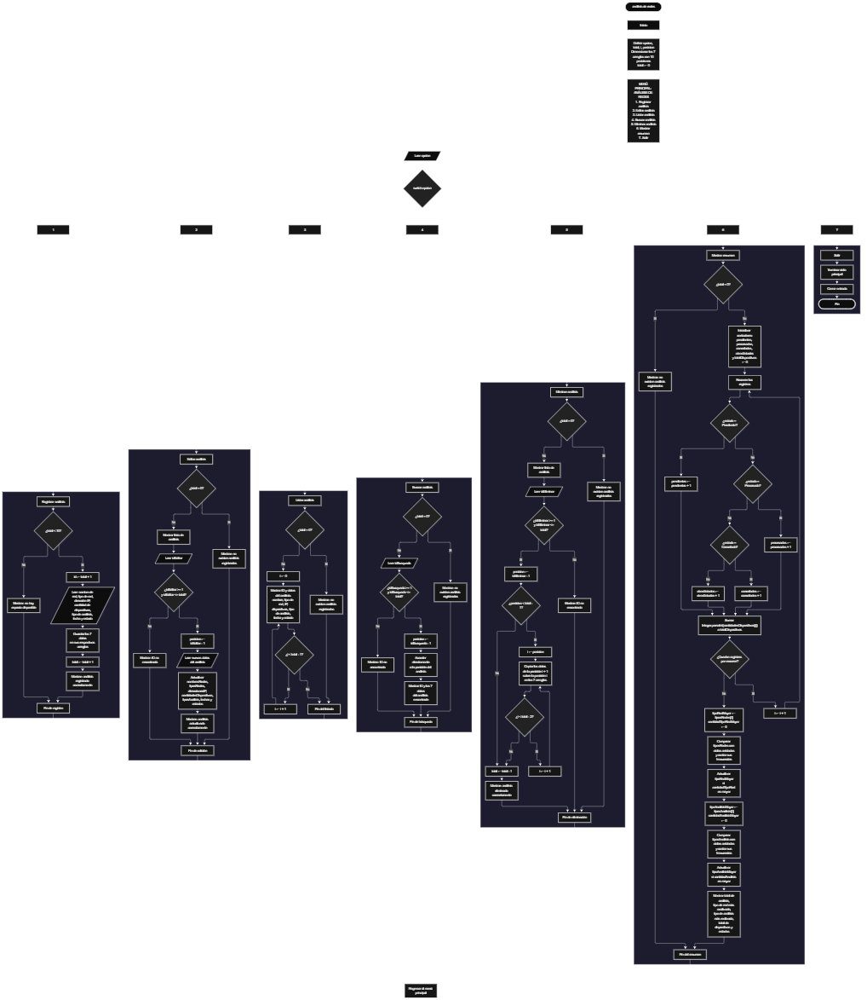

Este proyecto, llamado <b>análisis de redes</b>, fue desarrollado en <b>java</b> como un ejercicio práctico para fortalecer la lógica de programación mediante la creación de un sistema de gestión de análisis de redes desde la consola. El programa cuenta con un menú principal de siete opciones que permite <b>registrar, editar, listar, buscar, eliminar y consultar un resumen</b> de los análisis registrados. Cada análisis almacena datos como el nombre de la red, el tipo de red, la dirección ip, la cantidad de dispositivos, el tipo de análisis, la fecha y el estado, utilizando arreglos con una capacidad máxima de <b>10 registros durante la ejecución</b>. Durante su desarrollo se aplicaron conceptos fundamentales de programación, como variables, arreglos, estructuras condicionales, ciclos repetitivos y estructuras de selección, además de procesos para buscar, modificar, eliminar y organizar registros. Este proyecto permite poner en práctica los conocimientos adquiridos en Java y sirve como base para desarrollar sistemas de gestión más avanzados utilizando otros lenguajes y tecnologías.

<h2 align="center">⚙️ Funcionamiento del menú principal</h2>

### ➕ Registrar análisis

La opción <b>1) registrar análisis</b> permite almacenar un nuevo análisis de red. Antes de realizar el registro, el sistema comprueba que la cantidad de análisis almacenados sea menor a <b>10</b>, utilizando la condición <b>total &lt; nombresRedes.length</b>. Si existe espacio disponible, el programa genera un identificador mediante la variable <b>id</b>, cuyo valor corresponde a <b>total + 1</b>, y solicita el <b>nombre de la red, tipo de red, dirección ip, cantidad de dispositivos, tipo de análisis, fecha y estado</b>. Los datos se almacenan en la posición correspondiente de sus respectivos arreglos. Finalmente, muestra el mensaje <b>"analisis registrado correctamente."</b> y aumenta la variable <b>total</b> en uno. Si los arreglos alcanzan su capacidad máxima, presenta el mensaje <b>"no hay espacio disponible para registrar mas analisis."</b>, impidiendo almacenar otro registro.

### ✏️ Editar análisis

La opción <b>2) editar análisis</b> permite modificar la información de un análisis registrado. Primero, el programa comprueba si existen registros almacenados mediante la variable <b>total</b>. Si no hay registros, muestra el mensaje <b>"no existen analisis registrados."</b>. En caso contrario, presenta una lista con los identificadores y los datos de cada análisis. Después, solicita el identificador del registro que se desea editar y comprueba que esté dentro del rango permitido mediante la condición <b>idEditar &gt;= 1 && idEditar &lt;= total</b>. Si la selección es válida, utiliza la variable <b>posicion</b> para acceder a la posición correspondiente mediante <b>idEditar - 1</b>. A continuación, solicita nuevamente el nombre de la red, tipo de red, dirección ip, cantidad de dispositivos, tipo de análisis, fecha y estado, actualizando directamente los valores de los arreglos correspondientes. Finalmente, presenta el mensaje <b>"analisis actualizado correctamente."</b>. Si el identificador seleccionado no corresponde a un análisis registrado, informa que el identificador no fue encontrado.

### 📋 Listar análisis

La opción <b>3) listar análisis</b> permite visualizar todos los análisis registrados actualmente en el sistema. Antes de mostrar la información, el programa comprueba si la variable <b>total</b> es igual a cero. Si no existen registros, presenta el mensaje <b>"no existen analisis registrados."</b>. Si hay análisis disponibles, utiliza un ciclo <b>for</b> para recorrer los arreglos desde la primera posición hasta el número total de registros almacenados. Durante el recorrido, muestra el identificador, el nombre de la red, el tipo de red, la dirección ip, la cantidad de dispositivos, el tipo de análisis, la fecha y el estado de cada registro. Esta función facilita consultar los análisis existentes sin necesidad de buscar cada uno individualmente.

### 🔎 Buscar análisis

La opción <b>4) buscar análisis</b> permite localizar un análisis mediante su identificador. Primero, el programa comprueba si existen registros almacenados. Si no hay análisis, muestra el mensaje <b>"no existen analisis registrados."</b>. En caso contrario, solicita el identificador del análisis que se desea buscar y comprueba que esté dentro del rango permitido mediante la condición <b>idBusqueda &gt;= 1 && idBusqueda &lt;= total</b>. Cuando el identificador es válido, utiliza la variable <b>posicion</b> para acceder a la posición correspondiente mediante <b>idBusqueda - 1</b> y muestra todos los datos del análisis seleccionado. Si el identificador introducido no corresponde a ningún registro almacenado, presenta el mensaje <b>"id no encontrada."</b>. La búsqueda se realiza únicamente mediante el identificador del análisis.

### 🗑️ Eliminar análisis

La opción <b>5) eliminar análisis</b> permite eliminar un análisis registrado mediante su identificador. Antes de comenzar, el programa comprueba que existan registros almacenados. Si no hay análisis, muestra el mensaje <b>"no existen analisis registrados."</b>. Si hay registros disponibles, presenta una lista con la información de los análisis. Después, solicita el identificador del registro que se desea eliminar y verifica que la selección esté dentro del rango válido. Si el análisis existe, utiliza la variable <b>posicion</b> para identificar su ubicación y comienza el proceso de eliminación. Para mantener los registros organizados, utiliza un ciclo <b>for</b> controlado por la variable <b>i</b>, que desplaza una posición hacia atrás los datos de los análisis posteriores en los arreglos <b>nombresRedes, tiposRedes, direccionesIP, cantidadesDispositivos, tiposAnalisis, fechas y estados</b>. Posteriormente, disminuye la variable <b>total</b> en uno y muestra el mensaje <b>"analisis eliminado correctamente."</b>. Si el identificador seleccionado no corresponde a un análisis registrado, informa que el identificador no fue encontrado.

### 📊 Mostrar resumen

La opción <b>6) mostrar resumen</b> permite consultar información general de los análisis registrados. Primero, el programa comprueba si existen registros almacenados. Si no hay análisis, muestra el mensaje <b>"no existen analisis registrados."</b>. En caso contrario, utiliza ciclos <b>for</b> para recorrer los arreglos y contabilizar los estados <b>pendiente, procesado, cancelado y otros estados</b>. También calcula la cantidad total de dispositivos analizados mediante la conversión de los valores almacenados en el arreglo <b>cantidadesDispositivos</b> a números enteros utilizando <b>Integer.parseInt()</b>. Además, emplea ciclos anidados para comparar los valores de los arreglos <b>tiposRedes</b> y <b>tiposAnalisis</b>, identificando el tipo de red más frecuente y el tipo de análisis más realizado. Finalmente, muestra el total de análisis registrados, el tipo de red más analizado, el tipo de análisis más realizado, la cantidad total de dispositivos analizados y el conteo de los diferentes estados.

### 🚪 Salir del menú principal

La opción <b>7) salir</b> está destinada a finalizar la ejecución del programa y muestra el mensaje <b>"hasta pronto."</b>. El menú principal se encuentra dentro de una estructura repetitiva <b>do ... while</b>, que mantiene el programa en funcionamiento mientras se realizan las operaciones disponibles. La condición final es <b>while (opcion != 7)</b>, por lo que seleccionar la opción 7 permite finalizar el ciclo y cerrar el objeto <b>entrada</b> mediante <b>entrada.close()</b>.

<h2 align="center">🧠 Temas aplicados en el proyecto</h2>

### 📦 Variables

En este proyecto se utilizan variables para guardar la opción seleccionada en el menú, controlar la cantidad de análisis registrados, recorrer los arreglos, seleccionar los registros que se desean editar, eliminar o consultar, almacenar los identificadores y realizar los cálculos del resumen. Cada variable cumple una función específica dentro de las operaciones de gestión de análisis de redes.

🔢 **opcion:** Almacena la opción seleccionada por el usuario en el menú principal.

📊 **total:** Almacena la cantidad actual de análisis registrados.

🔄 **i:** Funciona como contador en los ciclos <b>for</b> y permite recorrer las posiciones de los arreglos.

🔁 **posicion:** Permite identificar la posición correspondiente al análisis seleccionado mediante su identificador.

🔎 **idBusqueda:** Almacena el identificador introducido por el usuario para realizar la búsqueda.

📈 **totalDispositivos:** Acumula la cantidad de dispositivos correspondientes a los análisis registrados.

### 🗃️ Arreglos

En este proyecto se utilizan siete arreglos relacionados con los datos de cada análisis de red. Cada arreglo tiene una capacidad de <b>10 posiciones</b> y utiliza el mismo índice para representar la información correspondiente a un mismo registro. Por ejemplo, los datos de un análisis almacenado en la posición <b>0</b> se encuentran distribuidos entre <b>nombresRedes[0], tiposRedes[0], direccionesIP[0], cantidadesDispositivos[0], tiposAnalisis[0], fechas[0] y estados[0]</b>. Esta organización permite recorrer, buscar, modificar, mostrar y eliminar los análisis de manera ordenada.

📝 **nombresRedes[10]:** Almacena los nombres de las redes registradas.

🌐 **tiposRedes[10]:** Almacena los tipos de redes correspondientes a cada análisis.

📡 **direccionesIP[10]:** Almacena las direcciones ip de las redes.

🔢 **cantidadesDispositivos[10]:** Almacena las cantidades de dispositivos de cada análisis.

📊 **tiposAnalisis[10]:** Almacena los tipos de análisis realizados.

📅 **fechas[10]:** Almacena las fechas de los análisis registrados.

📌 **estados[10]:** Almacena los estados de cada análisis.

### 🔀 Estructuras condicionales

En este proyecto se utilizan las estructuras <b>if</b> y <b>else</b> para comprobar si existe espacio disponible antes de registrar un análisis, verificar si existen registros antes de realizar determinadas operaciones, validar el identificador seleccionado para editar, buscar o eliminar un análisis y determinar la clasificación de los estados durante la elaboración del resumen. Estas condiciones permiten que el programa responda de manera diferente según la cantidad de registros almacenados y el resultado de cada operación.

### 🔄 Estructuras repetitivas

En este proyecto se utilizan los ciclos <b>for</b> y <b>do ... while</b>. Los ciclos <b>for</b> permiten recorrer los arreglos para mostrar los análisis, acceder a los registros seleccionados, desplazar los datos durante la eliminación y realizar los conteos del resumen. También se utilizan ciclos <b>for</b> anidados para comparar los tipos de redes y los tipos de análisis, identificando cuáles aparecen con mayor frecuencia. Por otro lado, el ciclo <b>do ... while</b> mantiene activo el menú principal para que el usuario pueda ejecutar diferentes operaciones antes de salir del programa.

### 🎯 Estructura switch

El programa evalúa el valor almacenado en la variable <b>opcion</b> y ejecuta el bloque de instrucciones correspondiente mediante la estructura <b>switch</b>. Cada caso representa una operación específica del sistema: <b>registrar, editar, listar, buscar, eliminar, mostrar resumen o salir</b>. También se utiliza el bloque <b>default</b> para mostrar un mensaje cuando el usuario introduce un número que no coincide con ninguna de las opciones definidas.

### 🔢 Dimensionamiento de arreglos

El programa utiliza arreglos de tipo <b>String</b> con una capacidad de <b>10 posiciones</b> para almacenar la información de los análisis de redes. Esta capacidad se establece directamente al declarar cada arreglo. La cantidad de posiciones ocupadas se controla mediante la variable <b>total</b>, por lo que las operaciones recorren únicamente los registros comprendidos entre la primera posición y el total actual de análisis almacenados.

### 🔄 Reorganización de registros

Cuando se selecciona un análisis para eliminarlo, el programa utiliza un ciclo <b>for</b> que comienza en la posición seleccionada y llega hasta <b>total - 1</b>. En cada repetición, los datos de la posición siguiente se copian sobre la posición actual en los siete arreglos: <b>nombresRedes, tiposRedes, direccionesIP, cantidadesDispositivos, tiposAnalisis, fechas y estados</b>. Después, la variable <b>total</b> disminuye en uno. De esta manera, los análisis posteriores ocupan las posiciones anteriores sin dejar espacios vacíos entre los registros activos.

<h2 align="center">¿Cómo se implementaron las operaciones crud en el proyecto?</h2>

Las operaciones <b>crud</b> se implementaron mediante las opciones del menú principal, permitiendo administrar los análisis de redes registrados. La operación <b>crear</b> corresponde a <b>registrar análisis</b>, donde se introducen los datos de un nuevo registro; <b>leer</b> se realiza mediante las opciones <b>buscar análisis y listar análisis</b>; <b>actualizar</b> corresponde a <b>editar análisis</b>, donde se modifican los datos de un registro existente; y <b>eliminar</b> se realiza mediante la opción <b>eliminar análisis</b>. Estas operaciones utilizan variables, arreglos, condicionales y ciclos para gestionar la información almacenada temporalmente durante la ejecución del programa.

<h2 align="center">Diagrama de flujo del proyecto</h2>

<h2 align="center">🛡️ Validaciones del programa</h2>

### 📭 No existen análisis registrados

Esta validación se utiliza en las opciones de <b>editar, listar, buscar, eliminar y mostrar resumen</b>. El programa comprueba si la variable <b>total</b> es igual a <b>0</b> y, si no existen análisis registrados, muestra el mensaje <b>"no existen analisis registrados."</b>. Esta comprobación evita continuar con las operaciones que necesitan información almacenada cuando no hay registros disponibles.

### ⚠️ Capacidad máxima alcanzada

Esta validación se utiliza durante el registro de nuevos análisis para controlar la capacidad máxima de los arreglos. El programa comprueba si <b>total &lt; nombresRedes.length</b> antes de permitir agregar un nuevo registro. Si existe espacio disponible, solicita los datos del análisis y aumenta el contador. En caso contrario, muestra el mensaje <b>"no hay espacio disponible para registrar mas analisis."</b>, impidiendo registrar más análisis mientras se mantenga la capacidad máxima.

### ❌ Identificador no encontrado

Esta validación se utiliza durante las operaciones de edición, búsqueda y eliminación de análisis. El programa comprueba que el identificador introducido se encuentre dentro del rango comprendido entre <b>1</b> y <b>total</b>. Si el identificador corresponde a un registro existente, permite continuar con la operación solicitada. En caso contrario, muestra un mensaje indicando que el identificador no fue encontrado.

### 🔢 Selección de análisis

El programa utiliza la variable <b>posicion</b> para identificar la ubicación del análisis que se desea editar, buscar o eliminar. Después de comprobar que el identificador introducido sea mayor o igual a <b>1</b> y menor o igual al valor de <b>total</b>, obtiene la posición correspondiente restando uno al identificador mediante la operación <b>id - 1</b>. Esta conversión permite acceder a la posición correcta dentro de los arreglos, ya que sus índices comienzan en cero.

### ⚠️ Opción inválida

La estructura <b>switch</b> incluye el bloque <b>default</b>, que muestra un mensaje cuando el usuario introduce un número que no corresponde a ninguna de las opciones definidas en el menú principal. Esta comprobación permite informar al usuario que debe seleccionar una de las opciones disponibles para continuar utilizando el programa.

<h2 align="center">🎯 Objetivo del proyecto</h2>

El objetivo principal de este proyecto es fortalecer la <b>lógica de programación</b> mediante el desarrollo de un sistema de gestión de análisis de redes en <b>java</b>. A través de su construcción se busca aplicar los conocimientos adquiridos sobre variables, arreglos, estructuras condicionales, ciclos repetitivos y estructuras de selección, integrándolos para resolver un problema de manera organizada. Además, el proyecto permite comprender cómo registrar, consultar, modificar y eliminar información, así como realizar conteos y obtener resultados a partir de los datos almacenados en una aplicación de consola.

